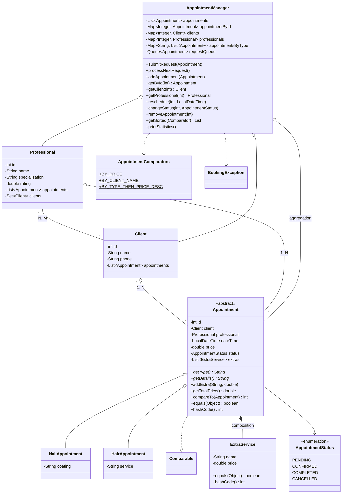

# Appointment Booking System

Appointment booking system for a beauty salon (nail and hair services): clients submit requests,
professionals process them from a queue, appointments can be rescheduled, completed, cancelled and deleted.
All data is stored in the Java Collection Framework.

**Class hierarchy:** `Appointment` → `NailAppointment`, `HairAppointment`

## How to run
```bash
javac -d out src/*.java
java -cp out Main
```
Or in IntelliJ IDEA: open `src/Main.java` → Run.

## Files
| File | Purpose |
|---|---|
| `Appointment` | abstract appointment, `Comparable`, `equals/hashCode` by id |
| `NailAppointment`, `HairAppointment` | concrete appointment types |
| `Client`, `Professional` | users of the system |
| `ExtraService` | extra service inside an appointment (composition) |
| `AppointmentStatus` | PENDING, CONFIRMED, COMPLETED, CANCELLED |
| `AppointmentManager` | service layer: collections, CRUD, queue, search, statistics |
| `AppointmentComparators` | 3 comparators |
| `BookingException` | custom exception |
| `Main` | demo of all features |

## Java Collection Framework usage
| Block | Collection | Where | Why |
|---|---|---|---|
| A | `ArrayList<Appointment>` | `AppointmentManager.appointments` | main registry of appointments |
| A | `HashSet<Client>` | `Professional.clients` | N:M relationship without duplicates |
| B | `HashMap<Integer, Appointment>` | `appointmentById` | O(1) lookup of appointment by id |
| B | `HashMap<Integer, Client>`, `HashMap<Integer, Professional>` | `clients`, `professionals` | O(1) lookup of users by id |
| B | `HashMap<String, List<Appointment>>` | `appointmentsByType` | grouping by service type |
| C | `Comparable<Appointment>` | `Appointment.compareTo` | natural order: date, then id |
| C | 3 × `Comparator` | `AppointmentComparators` | by price, by client name, by type + price |
| D | `ArrayDeque<Appointment>` (Queue) | `requestQueue` | FIFO queue of booking requests |

## UML class diagram


## User roles
- **Client** submits a request → `submitRequest()` → `Queue.offer()`
- **Professional** processes requests one by one → `processNextRequest()` → `Queue.poll()`
